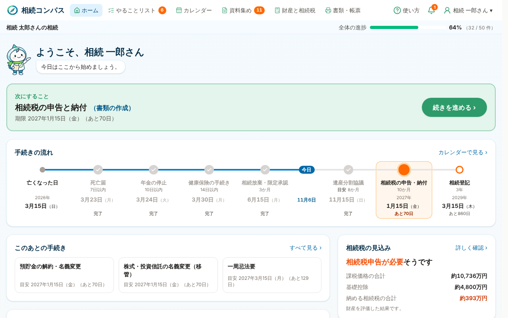
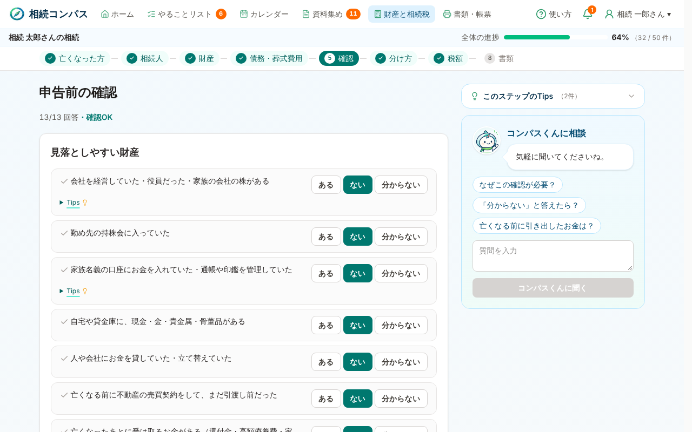
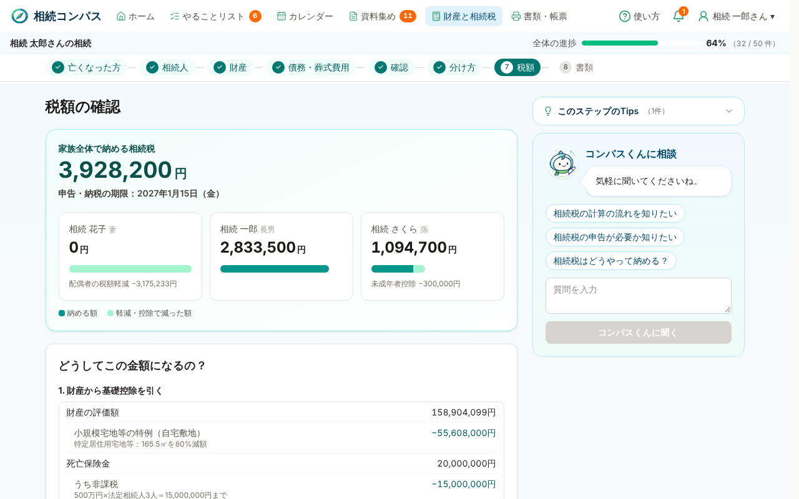
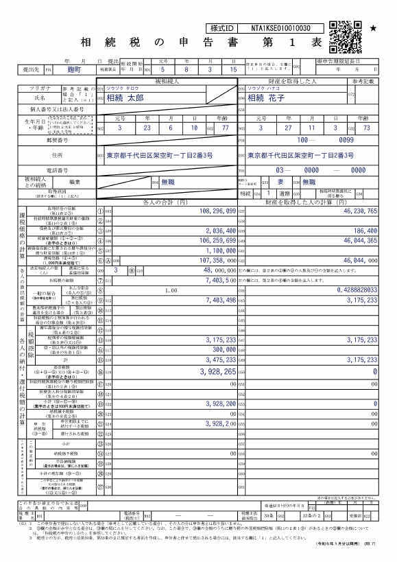

# 相続コンパス（souzoku-compass）

**このプロジェクトは、家族を亡くしたばかりの一般の方が抱える「何から手を付ければいいか分からない・相続税の申告を自分で進められない」という課題を、聞き取りから手続きの案内・財産の評価・正式様式の申告書づくりまで一緒に進める形に変える Web アプリです。**

Built with Claude: Japan 2026 ハッカソン（テーマ1「あなたにしかない深さを」）の作品です。リポジトリのコードはすべてハッカソン期間中（2026年11月2日以降）に書きました（[期間中に作ったことの明示](#期間中に作ったことの明示)）。

- アプリ：https://souzoku-compass-687769965434.asia-northeast1.run.app （登録なしで「デモを見る」から架空の家族で試せます）
- デモ動画：（提出時に追記します）


## 背景

会計事務所で相続税申告の実務に携わるなかで、次のような場面を何度も見てきました。

- 家族が亡くなった直後は、死亡届・年金・健康保険・相続放棄・準確定申告・相続税・相続登記と、期限の違う手続きが一度に押し寄せます。何が自分の家族に必要なのかが分からないまま、期限だけが過ぎていきます
- 相続税の申告が必要かどうかは、財産を集めて評価してみるまで分かりません。基礎控除をわずかに超えるだけの家庭でも、専門家に頼むか自分でやるかを、判断材料のないまま決めることになります
- 自分で申告しようとしても、土地の評価（路線価図の読み方）や小規模宅地等の特例、生命保険金の非課税といった論点でつまずきます。さらに名義預金や亡くなる前の引き出しなどの「計上漏れ」は、税務調査で指摘されて初めて気づくことが多くあります

税理士向けのソフトは「分かっている人」の入力を速くするものです。分からない人が、正しい順番で、根拠を確かめながら進められる道具はありませんでした。相続コンパスは、その不足を埋めるために作りました。

## 主な機能

### 1. 最初の聞き取りで、家族に必要な手続きと期限が分かる

約3分の質問（家族構成・財産のおおよそ・今どの段階か）から、その家族に必要な手続き・期限・提出先を出します。基礎控除以下なら「相続税の申告は不要」と分かります。期限は祝日を考えて計算し、手続きの流れ・やることリスト・カレンダーで見られます。




### 2. 書類を撮影すると、コンパスくん（Claude）が仕分けて財産に登録する

残高証明書や保険金の支払通知書を撮影・アップロードすると、Claude が書類の種類を見分け、金額や口座を読み取って財産に登録します。読み取った内容は「確認待ち」として表示し、利用者が確かめます。税務署に出す書類一式の PDF もまとめられます。


### 3. 地図で土地を選ぶと、国税庁の路線価図を探して重ねる

地図で土地をクリックすると、国税庁の路線価図・評価倍率表を自動で探し、地図に重ねて表示します。土地の枠と道路は地図から取り、路線価の表記（例：420D）は Claude が候補として読み取り、利用者が路線価図と見比べて確定します。

### 4. 申告前の確認で、計上漏れと過去のお金の動きを確かめる

会社への貸付・名義預金・貴金属・亡くなる前の引き出しなど、見落としやすい13の論点を決まった質問で確認します。「ある」と答えた論点だけコンパスくんが聞き取り、結論（財産に追加・該当なし・税理士に相談）はサーバー側のルールで決めます。



### 5. 税額は決定論的な計算エンジンで、内訳まで見せる

相続人の判定・財産評価・特例・税額控除は、Claude ではなく TypeScript の計算エンジン（BigInt の分数で厳密計算）が計算します。小規模宅地等の特例や保険金の非課税がいくら効いたかを内訳で示します。



### 6. 国税庁の正式様式で申告書を出力する

令和8年分の申告書（第1表〜第15表、付表を含む）に計算結果を記入した PDF を出力します。遺産分割協議書、相続登記の申請書も作れます。確認が終わるまでは「下書き」と入ります。



### 機能の一覧

| 分野 | 内容 |
| --- | --- |
| 手続きの案内 | 聞き取りから、必要な手続き・期限・提出先を一覧に（やることリスト、カレンダー、手続きの流れ）。祝日を考えた期限、窓口の連絡先の検索、カレンダーアプリへの登録 |
| 資料集め | 必要な書類のチェックリスト、書類の撮影（枠の自動検出）と種類ごとの自動仕分け、Claude による読み取りと財産への登録、税務署に出す書類一式の PDF |
| 相続人 | 配偶者・子（養子の人数制限を含む）・直系尊属・兄弟姉妹（半血）・代襲相続・相続放棄。郵便番号から住所を入力 |
| 財産 | 預貯金（既経過利息）・現金・土地（路線価方式／倍率方式、複数の道路に面する土地）・建物・分譲マンション（区分所有補正率）・上場株式・生命保険金・退職手当金・家庭用財産・亡くなったあとに受け取るお金 |
| 特例・控除 | 小規模宅地等の特例（特定居住用・特定事業用・貸付事業用、限度面積の調整、有利な選び方）・生命保険金等の非課税・配偶者の税額軽減・未成年者控除・障害者控除・相次相続控除・2割加算・暦年課税と相続時精算課税の贈与加算・代償金 |
| 申告前の確認 | 計上漏れと過去のお金の動きを13の質問で確認。必要なときだけコンパスくんが聞き取り、結論はルールで決める |
| 申告書 | 第1表・第1表（続）・第2表・第5表・第6表・第7表・第8の8表・第9表・第10表・第11表と付表1〜4・第11・11の2表の付表1・第13表・第14表・第15表・第15表（続） |
| 協議書・登記 | 遺産分割協議書（未成年者の特別代理人の案内つき）、相続登記の申請書と登録免許税 |
| 税理士への相談 | 自動で判断できない論点は、理由をまとめて画面から税理士事務所に相談できます |

非上場株式、国外財産、非居住者、配偶者居住権、納税猶予などは自動では完結させず、画面で税理士への相談を案内します。

## Claude の活用

### アプリの中での Claude（コンパスくん）

「計算は決定論的に、Claude は人と書類の間をつなぐ役」と役割を分けています。税額や「相続税がかかるか」の判定に Claude は関与しません。

| 使いどころ | Claude がすること | 安全のための仕組み |
| --- | --- | --- |
| 画面ごとの相談 | 利用者の質問に、その画面の文脈で答える | よくある質問は決まった回答を先に出す |
| 書類の読み取り（`/api/extract`） | 残高証明書・保険金の通知書などから金額・口座・日付を構造化して取り出す | JSON スキーマで出力を固定。推測で埋めない。結果は「確認待ち」にして利用者が確かめる |
| 書類の仕分け（`/api/classify`） | 撮影した書類の種類を判定する | 決まった書類の種類から選ばせ、当てはまらなければ「その他」に入れる。中身の氏名や番号は返させない |
| 路線価図の読み取り | 土地の周りの路線価の表記を候補として読む | 値は自動採用せず、利用者が路線価図と見比べて確定 |
| 申告前の聞き取り（`/api/review`） | 「ある」と答えた論点を会話で深掘りする | 結論（追加・該当なし・相談）はサーバー側のルールで検査してから採用 |
| 窓口の連絡先の検索（`/api/offices`） | Web 検索ツールで税務署・法務局などの連絡先を探す | 提出先の種類はルールで決め、Claude は連絡先を探すだけ |

Claude を呼ぶ API は、Origin の検査と IP ごとの回数制限で守っています（`src/server/guard.ts`）。

### 開発の中心にした Claude Code

このリポジトリのコードは、Claude Code（claude.ai/code のクラウドセッション）が書いています。開発者は会計事務所の実務の知見から「何を作るか・どこが正しくないか」を指示し、確認する役に徹しました。

- **用途ごとに会話を分けて並行開発**：初期構築、土地評価、書類の撮影、申告前の確認、進めない箇所の総点検などを別々のスレッドで同時に進め、それぞれがブランチと PR（29件）を作って main にマージしました
- **サブエージェントとワークフロー**：1000件の相続ケースの生成と検算、スマートフォン幅（360/375/390px）での全画面の表示崩れの点検など、量の多い作業をサブエージェントに分けて並列に進めました
- **MCP**：GitHub MCP で PR の作成・CI の確認・レビューへの対応を行いました
- **Remote Control**：クラウド環境には GCP の認証情報を置かず、デプロイは開発者の PC 上の Claude Code（Remote Control）から `gcloud run deploy` で行いました
- **検証を自動に**：計算エンジンとは別に書いた検算プログラムで1000件を照合し、単体テスト（1477件）と型検査・lint・ビルドを CI で毎回回しています
- **別の AI によるレビュー**：Codex や ChatGPT に実機で触ってもらった指摘を Claude Code に渡し、再現・修正・テスト追加まで行いました

## 試行錯誤の記録

開発中のつまずきと、どう直したかの主なものです。経緯はコミット履歴と PR に残っています。

| つまずき | 対処 |
| --- | --- |
| 路線価図を地図に重ねる方法 | 最初は利用者が路線価図と地図で同じ点を2〜3か所選ぶ方式。次に、クリックした場所から国税庁の町丁名索引をたどって路線価図を自動で探すようにした。福岡市博多区など索引の形式が違う地域で見つからない不具合を、実際の索引に合わせて直した |
| 小規模宅地等の特例の結果が、入力の順番で変わる | 外部レビューで発覚。限度面積の割り当てを、順番に依存しない決定論的な探索に作り直した |
| 計算が本当に正しいか | 計算エンジンとは別に検算プログラムを書き、1000件の架空ケースで照合する仕組みを作った |
| 本番だけ登録が 500 エラー | Firestore の SDK をバンドルしていたのが原因。サーバー外部パッケージにして解消 |
| 郵便番号データが取れないままデプロイされた | 日本郵便のダウンロード URL が2026年5月に変わっていた。新しい URL に直し、データが取れないときはビルドを止めるようにした |
| スマートフォンで聞き取りの画面が先頭に飛ぶ | iOS Safari ではボタンにフォーカスが当たらないため。タップした質問を基準にスクロールするよう直した |
| 画面の文字が多すぎる | 全画面の文字数を測り、見出しの繰り返しや長い説明を折りたたんで約38％減らした（14,873字 → 9,289字） |
| 読み取った内容を手で登録するのは一般の人には難しい | 読み取ったら自動で登録し、まとめて取り消せるようにした |
| マイナンバーの書類を預かるリスク | 提出書類の欄は「ご自身で用意」にし、アップロード・保存をすべて止めた |

## 技術構成とセットアップ

- Next.js（App Router）／TypeScript／Tailwind CSS
- 計算エンジン：TypeScript（BigInt の分数で厳密計算）
- PDF：pdf-lib（国税庁様式の画像に記入）
- 地図：Leaflet と国土地理院 地理院タイル
- Claude：Anthropic TypeScript SDK
- 保存：Cloud Firestore（ログイン時）、ブラウザの localStorage／IndexedDB（デモ）
- 実行環境：Google Cloud Run（Dockerfile）、CI：GitHub Actions

```
src/domain/          計算エンジン（相続人の判定、財産評価、相続税額）
src/forms/           申告書の各欄への割り当てと PDF 化（r08/layout.json は欄の座標）
src/documents/       遺産分割協議書
src/components/      申告の8ステップ、マイページ（やることリスト・カレンダー・資料集め）、地図と路線価図の重ね表示
src/app/api/         Claude（案内・抽出・仕分け・路線価図の読み取り・申告前の聞き取り）、PDF 作成、住所検索の中継、ログインと保存
src/server/          Claude の呼び出し、API の保護、ログインと保存
scripts/forms/       国税庁様式の画像化と欄の座標の校正ツール
scripts/cases/       1000件のケースと、エンジンとは別に書いた検算プログラム
```

計算の根拠（民法・相続税法・租税特別措置法・財産評価基本通達）は各ソースのコメントに記載しています。

### ローカルで動かす

```bash
npm ci
npm run dev        # http://localhost:3000
npm test           # 単体テスト
npx tsx scripts/cases/run.ts   # 1000件のケースを検算プログラムと照合
npm run demo:pdf   # デモ案件の申告書（demo.pdf）と遺産分割協議書（division.pdf）を作成
```

### 環境変数

| 名前 | 用途 |
| --- | --- |
| `ANTHROPIC_API_KEY` | Claude を使う機能（相談・読み取り・仕分け・路線価図の読み取り・申告前の聞き取り・窓口の検索）。未設定でも、それ以外の機能はすべて動きます |
| `CLAUDE_MODEL` | 使うモデル（省略時は `claude-opus-5-5`） |
| `USE_FIRESTORE` | `1` でローカルでも Firestore に保存（Cloud Run 上では自動で Firestore を使います。未設定のローカルではメモリに保存） |

キーそのものはリポジトリに含めていません。Cloud Run では Secret Manager から渡しています。

### Cloud Run へのデプロイ

```bash
gcloud run deploy souzoku-compass --source . --region asia-northeast1 \
  --set-secrets ANTHROPIC_API_KEY=<シークレット名>:latest
```

ビルド時に日本郵便の郵便番号データを取得します（取得できないとビルドが止まります）。

## 期間中に作ったことの明示

- 最初のコミットは 2026年11月2日 12:42（JST）の `create-next-app` の雛形です。それ以降のコミットはすべてハッカソン期間中のものです
- 開発者が以前に作った税理士向けアプリのコードは使っていません。参考にしたのは業務上の課題・税務の論点だけで、計算方法は公開資料を根拠に新たに実装しました（[docs/clean-room.md](docs/clean-room.md)）
- キャラクター「コンパスくん」の画像（`public/brand/`）は、期間中の2026年11月2日に開発者が作成したものです
- 期間外のものとして使っているのは、次の公開データ・ライブラリだけです（下の「出典・ライセンス」）

## 出典・ライセンス

- 申告書の様式：出典：国税庁ウェブサイト（相続税の申告書等の様式一覧（令和8年分用））を加工して作成
- 地図：国土地理院 地理院タイル、住所検索・逆ジオコーダ
- 路線価図：国税庁「財産評価基準書 路線価図・評価倍率表」から取得したものを表示します（アプリには含みません）
- 郵便番号データ：日本郵便株式会社の郵便番号データ（ビルド時に取得）
- フォント：IPAフォント（IPAゴシック）。[IPAフォントライセンスv1.0](assets/fonts/IPA_Font_License.txt)
- npm パッケージ：`package.json` のとおり（各ライセンスに従います）
- データ：デモの人物・住所・金融機関・路線価図はすべて架空です

## ご注意

相続コンパスは申告書作成の手助けをするもので、税理士による確認の代わりにはなりません。提出前に必ず内容を確認してください。
